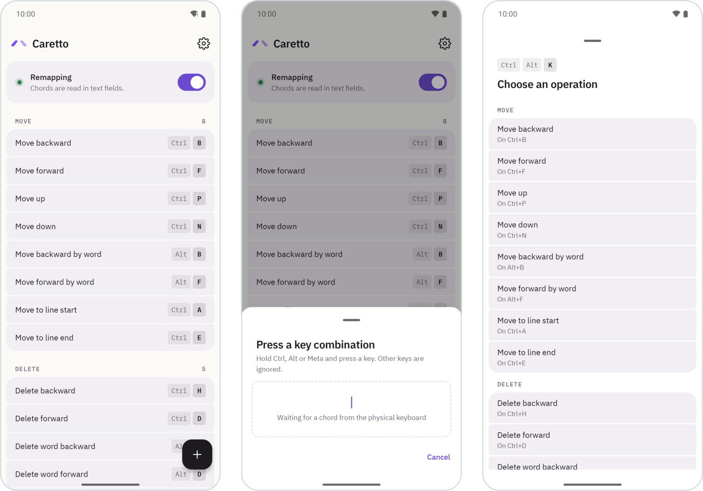

<div align="center">


# Caretto

**Emacs-style `Ctrl` chords on a physical keyboard for Android, only while you edit text.**

[Features](#features) · [Building](#building) · [Usage](docs/usage.md) · [Architecture](docs/architecture.md) · [Security](docs/security.md)

[](https://github.com/wadackel/caretto/actions/workflows/build.yml)
[](LICENSE)


</div>

<p align="center">
  <picture>
    <source media="(prefers-color-scheme: dark)" srcset="docs/images/hero-dark.png">
    
  </picture>
</p>

> [!NOTE]
> Caretto is a personal project, built for and tested on one Galaxy Z Fold. There are no
> prebuilt APKs: [build it from source](#building). Issues and pull requests are not open to
> outside contributors; security reports are welcome through
> [private vulnerability reporting](SECURITY.md).

## Features

### Your fingers keep their Emacs habits

`Ctrl+F` and `Ctrl+B` move the cursor, `Ctrl+A` and `Ctrl+E` go to the start and end of the line,
`Ctrl+H` and `Ctrl+D` delete, and `Ctrl+K` deletes to the end of the line. Word-wise movement and
deletion sit on `Alt`. Twenty bindings are set out of the box, these thirteen and the seven of
the Hyper layer below; the full table is in [`docs/usage.md`](docs/usage.md#key-map).

### Only in text fields

An editing chord is remapped only while a text field has focus. Everywhere else, and for every
key that is not bound, the key goes on to the app as it was pressed, so ordinary typing is never
retyped. Terminal apps such as Termius, Termux, JuiceSSH and ConnectBot are passed through whole,
so `Ctrl+H` and the rest still reach tmux and Neovim as Control sequences; add any other app
from a searchable list of what is installed.

### Edits, not replacement keys

A chord does not become a different key press. Caretto reads the text around the cursor and
applies the edit itself, through the editor connection Android has given accessibility services
since Android 13. That is why `Ctrl+A` lands on the start of the logical line, `Alt+H` deletes a
whole word, and emoji and other multi-code-point characters are moved over and deleted as one.

### Works beside your IME

Caretto is not a keyboard and does not replace one. Keep Gboard or Samsung Keyboard; Japanese and
other IME composition carries on as before, and movement works while text is still composing.

### A Hyper layer for the Mac's shortcuts

On a keyboard that can send `Ctrl+Alt+Shift+Meta` from a single key (ZMK and QMK firmware can),
that key becomes a Hyper modifier with the hand shape of `Cmd` on a Mac: `Hyper+C`, `X` and `V`
copy, cut and paste, `Hyper+Z` and `Y` undo and redo, `Hyper+A` selects all, and `Hyper+H` goes
home from any screen. Nothing on Android uses that combination, so nothing collides.

### Rebind anything

Press `+`, press the combination you want, and pick the operation. Tap a binding to change its key
or its operation. One operation can answer to several keys, and removing a binding or resetting
the map offers Undo.

### Nothing leaves the phone

Caretto has no network permission and no networking code, so nothing it reads can be sent
anywhere. It reads the text around the cursor only to compute one edit and never stores or logs
it. A quick settings tile turns the service off in one tap, for apps that refuse to run while an
unfamiliar accessibility service is on. The details are in [`docs/security.md`](docs/security.md).

## Limitations

> [!IMPORTANT]
> **A physical keyboard is required.** On-screen keyboards are out of scope.

- Deletion chords do nothing while IME text is composing; only the IME can edit composing text.
  Use the physical Backspace before committing.
- `Ctrl+P` and `Ctrl+N` move by the app's own idea of up and down, and `Ctrl+A` and `Ctrl+E` by
  logical lines, not by the lines as they wrap on screen.
- A terminal app has to be in the pass-through list to be left alone, since it looks like any
  other text field to Android. Four are listed by default.
- Requires Android 13 or later.

The rest are in [`docs/usage.md`](docs/usage.md#known-limitations).

## Building

You need JDK 17 and the Android SDK (platform 36), with `sdk.dir` in `local.properties` or
`ANDROID_HOME` pointing at it. With [Nix](https://nixos.org/download/) and flakes, `./gw` runs the
Gradle wrapper inside `nix develop`, which provides the JDK.

```sh
git clone https://github.com/wadackel/caretto.git
cd caretto
./gradlew :app:assembleDebug     # or ./gw :app:assembleDebug
adb install -r app/build/outputs/apk/debug/app-debug.apk
```

Open Caretto, press `Open settings` on the status row, and turn Caretto on in accessibility
settings. The status row then reads `Remapping`. [`docs/usage.md`](docs/usage.md) covers the
quick settings tile, the key map and the pass-through apps.

[`docs/development.md`](docs/development.md) covers the tests, the emulator scenarios and the
project layout, and describes the owner's own setup rather than a general one.

## License

Caretto is released under the [MIT License](LICENSE). The bundled IBM Plex fonts keep their own
licence (the SIL Open Font License), which ships in the APK and is shown on the app's About page
with the notices of the libraries it uses.
